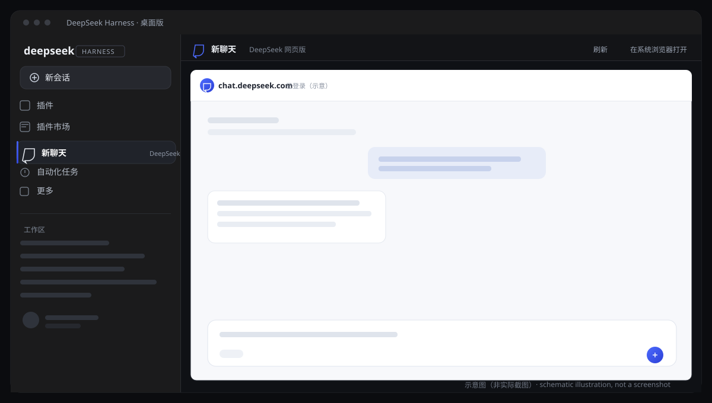
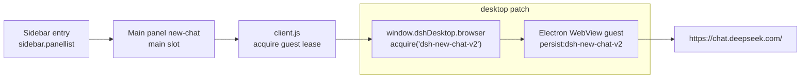

# New Chat · DSH New Chat

<p align="center"></p>

**English** · [简体中文](README.md)

[](https://github.com/shiyangjian6-code/dsh-new-chat/actions/workflows/ci.yml)
[](LICENSE)
[](desktop-support/README.md)


Adds a **New Chat** entry to the left sidebar of the DeepSeek Harness *desktop* app and
opens [chat.deepseek.com](https://chat.deepseek.com/) across the whole main content area.
A companion desktop patch keeps your **login across app restarts**, plus an optional
top-left **Restart** button plugin.

<p align="center"></p>
<p align="center"><sub>Schematic illustration (not a screenshot) · <a href="docs/assets/README.md">privacy-safe screenshots welcome</a></sub></p>

> [!WARNING]
> **Unofficial community project**, not affiliated with DeepSeek. The desktop patch
> modifies two files inside `resources/app.asar` of the locally installed DSH Desktop
> `0.2.1-rc.5`. It is version-locked, unofficial, and overwritten by application updates;
> applying it to another version can break startup. **Back up first**, and read
> [Security & privacy](#security--privacy) and [Compatibility & limits](#compatibility--limits).

## Features

- **Sidebar entry** — a navigation row like the built-in Plugins entries, switching the main panel.
- **Full-width page** — an Electron `WebView` guest fills the main column (not an iframe);
  press `Ctrl+B` to collapse the left sidebar for more room.
- **Persistent login** — with the patch, the chat guest always uses the persistent partition
  `persist:dsh-new-chat-v2`; cookies and site localStorage survive app restarts (including the
  Restart button). You sign in once.
- **Restart button** (separate plugin) — restarts the whole desktop app and Host, flushing
  persistent storage first.
- **Risk-control notice and fallback** — a Chinese notice explains DeepSeek rate-limit pages;
  "Open in system browser" is always available; without desktop WebView capabilities the panel
  shows an explanation instead of a blank page.
- **Privacy** — never reads or stores your credentials; no paid APIs.

## How it works



- **Why not an iframe**: `chat.deepseek.com` sends `Content-Security-Policy:
  frame-ancestors 'none'`, so no iframe can embed it. An Electron `<webview>` is a separate
  guest, not a frame.
- **Why login persists**: the stock desktop app always uses an in-memory browser partition.
  The patch switches to `persist:dsh-new-chat-v2` only for the chat workspace and flushes
  Chromium storage before quit/restart. All other browser partitions, lease ownership and
  isolation policy are unchanged. See [docs/architecture.md](docs/architecture.md).

## Repository layout

| Path | Contents |
|---|---|
| [`bundle/`](bundle/README.md) | Plugin `@local/dsh-new-chat` 1.1.0: sidebar entry + full-width WebView panel |
| [`restart-bundle/`](restart-bundle/README.md) | Optional plugin `@local/dsh-restart` 1.0.0: top-left Restart |
| [`desktop-support/`](desktop-support/README.md) | Desktop patch sources, version manifest and build/deploy tooling |
| [`docs/`](docs/install.md) | Install, architecture, troubleshooting, verification, publishing |
| [`scripts/`](scripts/verify.mjs) | Repository checks used by CI |

## Requirements

| Item | Requirement |
|---|---|
| OS | Windows 10/11 x64 |
| Harness | **DSH Desktop `0.2.1-rc.5`** (Electron 44.7.0) |
| Python | 3.11+ (only to build the patch) |
| Node.js | 22+ (only for repository checks/development) |

The builder verifies the SHA256 of the original `lib/main.js` and `lib/preload-app.cjs`
and refuses other versions.

## Quick start

Full steps, backup checklist and rollback: [docs/install.md](docs/install.md).

1. **Back up** the original `app.asar` and the profile config while Harness is closed.
2. **Build the patch**:

   ```powershell
   python desktop-support/tools/patch_asar.py `
     "D:\dsh\resources\app.asar" `
     "$env:USERPROFILE\dsh-backup\app.patched.asar"
   ```

   The builder writes `*.verification.json` (source/output hashes, replaced entries and
   verified unrelated entries — 16,649 on the reference machine).
3. **Deploy**: replace `D:\dsh\resources\app.asar` with the patched archive, keeping the
   sibling `app.asar.unpacked` directory.
4. **Install the plugins**: Settings → Plugins → install local directory, choose `bundle/`
   and `restart-bundle/`; or call `plugin_manager install_bundle` for each.
5. **Sign in once** in the New Chat panel, click Restart, then reopen New Chat — it should
   already be signed in.

## Uninstall & rollback

Remove the plugins from Settings → Plugins (or `plugin_manager remove_bundle`), then restore
the backed-up `app.asar` while the app is closed, keeping `app.asar.unpacked`. Optionally delete
`%APPDATA%\DSH Desktop\Partitions\dsh-new-chat-v2` to erase your website session. Details:
[docs/install.md#uninstall--rollback](docs/install.md#卸载与回滚).

## Security & privacy

- The plugins never read, store or upload credentials; signing in and chatting happen inside
  the embedded official page.
- The patch does not inspect or export cookies; it only flushes Chromium storage so the
  persistent partition lands on disk.
- The persistent partition holds **your own** DeepSeek website data locally under the Electron
  user-data directory, like any other browser app.
- The risk-control notice reads only the guest page title and the first 4000 characters of its
  text, **in memory**, to pick a message; nothing is stored or sent, and no input values are read.
- No paid APIs, no telemetry.
- The desktop patch is an **unofficial local modification**; use at your own risk, verify the
  patched-file SHA256 values recorded in `desktop-support/verification-result.json` (and the
  generated `*.verification.json` archive evidence), and only build from this repository's sources.

Report vulnerabilities per [SECURITY.md](SECURITY.md).

## Compatibility & limits

| Limit | Note |
|---|---|
| Windows desktop only | The browser-based Harness cannot embed the site (CSP); use the system browser fallback |
| Version-locked | Only DSH Desktop `0.2.1-rc.5`; re-adapt and rebuild after app updates |
| Sessions can still expire | Signing out elsewhere or a site-side expiry still requires a new login |
| Panel remount | Switching away and back reloads the page; server-side chat history is unaffected |
| Isolation policy | Popups, downloads and permissions follow the desktop guest policy; third-party login popups go to the system browser |

## Development & checks

```powershell
npm ci
npm run verify
python -m py_compile desktop-support/tools/patch_asar.py
```

See [CONTRIBUTING.md](CONTRIBUTING.md) and [CHANGELOG.md](CHANGELOG.md). CI runs the same
checks on Node 22/24.

## License & credits

Released under the [MIT license](LICENSE). `desktop-support/desktop/main.js` and
`preload-app.cjs` are modified copies of `@deepseek-ai/dsh-desktop@0.2.1-rc.5` (MIT);
original copyright belongs to DeepSeek. See [THIRD_PARTY_NOTICES.md](THIRD_PARTY_NOTICES.md).
