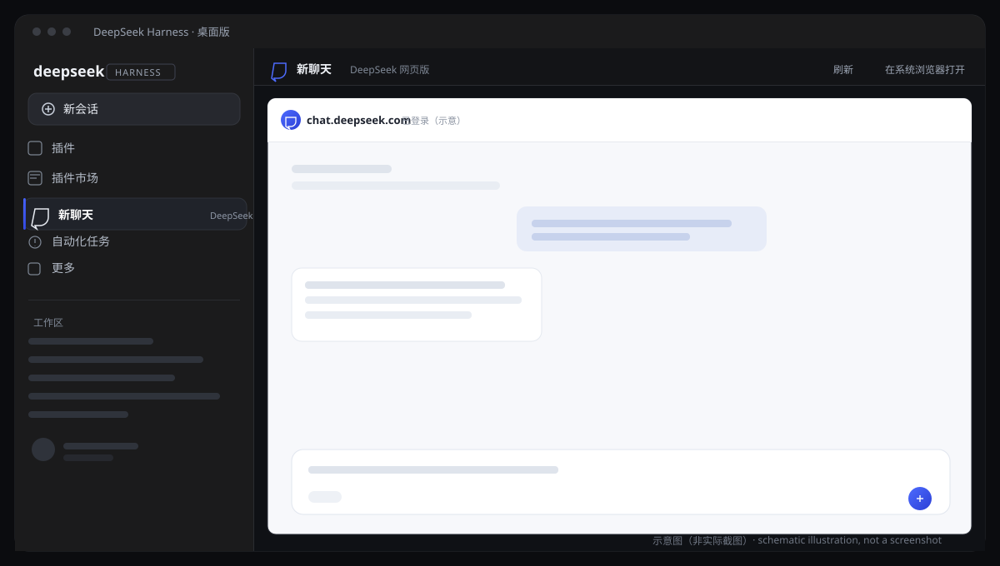
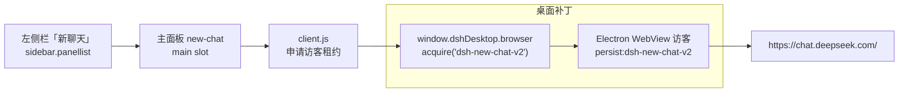

# 新聊天 · DSH New Chat

<p align="center"></p>

[English](README.en.md) · **简体中文**

[](https://github.com/shiyangjian6-code/dsh-new-chat/actions/workflows/ci.yml)
[](LICENSE)
[](desktop-support/README.md)


在 DeepSeek Harness **桌面版**左侧侧边栏增加「新聊天」入口：点击后在整个主内容区打开
[DeepSeek 网页版](https://chat.deepseek.com/)。配套桌面补丁让登录状态**跨应用重启保留**，
并附带一个可选的「重启」按钮插件。

<p align="center"></p>
<p align="center"><sub>界面示意图（非实际截图）· <a href="docs/assets/README.md">欢迎贡献脱敏截图</a></sub></p>

> [!WARNING]
> **非官方社区项目**，与 DeepSeek 官方无隶属关系。桌面补丁会修改本机
> `D:\dsh\resources\app.asar` 内的两个文件，属于按版本锁定的本地修改：应用升级会覆盖它，
> 装错版本可能导致应用无法启动。请先阅读 [安全与隐私](#安全与隐私) 与
> [兼容性与限制](#兼容性与限制)，并**务必先备份**。

## 功能

- **左侧栏入口**：与内置「插件」「插件市场」同一种形态的导航行，点击切换主面板。
- **全宽网页**：Electron `WebView` 访客占满主内容区（不是 iframe）；按 `Ctrl+B` 收起左侧栏更宽。
- **登录保持**：配合补丁，聊天访客固定使用持久分区 `persist:dsh-new-chat-v2`；
  应用重启（含「重启」按钮）后复用站点 Cookie 与 localStorage，只需首次登录一次。
- **重启按钮**（独立插件）：左上角「重启」，完整重启 App + Host，重启前先刷新持久存储。
- **风控提示与兜底**：官网限流/环境异常时给出中文提示；随时可「在系统浏览器打开」；
  没有桌面 WebView 能力时显示说明卡片而不是空白面板。
- **隐私**：不读取、不保存账号密码，不调用任何付费 API。

## 工作方式



- **为什么不是 iframe**：`chat.deepseek.com` 返回 `Content-Security-Policy:
  frame-ancestors 'none'`，任何 iframe 都会被浏览器拒绝；Electron `<webview>` 是独立访客，
  不受该限制。
- **登录为什么能保持**：原版桌面端把浏览器访客分区固定为内存分区。补丁仅在访客工作区为
  `dsh-new-chat-v2` 时改用 `persist:dsh-new-chat-v2`，并在退出/重启前刷新 Chromium 存储；
  其他浏览器分区、租约所有权与隔离策略保持不变。详见
  [架构说明](docs/architecture.md)。

## 仓库结构

| 路径 | 内容 |
|---|---|
| [`bundle/`](bundle/README.md) | 插件 `@local/dsh-new-chat` 1.1.0：左侧栏入口 + 全宽 WebView 面板 |
| [`restart-bundle/`](restart-bundle/README.md) | 可选插件 `@local/dsh-restart` 1.0.0：左上角「重启」 |
| [`desktop-support/`](desktop-support/README.md) | 桌面补丁源码、版本清单、构建/部署工具 |
| [`docs/`](docs/install.md) | 安装、架构、排障、验证、发布清单 |
| [`scripts/`](scripts/verify.mjs) | 仓库校验脚本（CI 使用） |

## 环境要求

| 项目 | 要求 |
|---|---|
| 系统 | Windows 10/11 x64 |
| Harness | **DSH Desktop `0.2.1-rc.5`**（Electron 44.7.0） |
| Python | 3.11+（仅构建桌面补丁时需要） |
| Node.js | 22+（仅仓库校验/开发时需要） |

补丁按版本锁定：构建工具会校验原版 `lib/main.js`、`lib/preload-app.cjs` 的 SHA256，
不符即拒绝；升级桌面版后不能套用旧补丁。

## 快速开始

> 完整步骤、备份清单、逐项验证与回滚方法见 [docs/install.md](docs/install.md)。

### 1. 备份（必做）

关闭 Harness 后，把原 `app.asar` 与当前 profile 配置复制到带日期的目录并记录哈希。

### 2. 构建补丁

```powershell
python desktop-support/tools/patch_asar.py `
  "D:\dsh\resources\app.asar" `
  "$env:USERPROFILE\dsh-backup\app.patched.asar"
```

输出旁会生成 `app.patched.asar.verification.json`：记录原/新档案 SHA256、替换条目和
核验过的无关条目数（本机验证为 16,649 项）。**输出文件必须不存在，源文件只读。**

### 3. 部署补丁

用补丁档案替换 `D:\dsh\resources\app.asar`；**保留旁边的 `app.asar.unpacked` 目录**。
不要覆盖正在运行的 Electron 档案。

### 4. 安装插件

**设置 → 插件 → 安装本地目录**，依次选择 `bundle/` 与 `restart-bundle/`；或让 Harness
智能体分别执行：

```text
plugin_manager install_bundle target = <仓库绝对路径>/bundle
plugin_manager install_bundle target = <仓库绝对路径>/restart-bundle
```

### 5. 首次登录并验证

1. 启动 Harness，点击左侧「新聊天」，完成一次登录（如微信扫码）。
2. 点击左上角「重启」。
3. 重启后再点「新聊天」：应直接处于登录状态，不需要再次扫码。

## 卸载与回滚

- **卸载插件**：设置 → 插件 → 停用/卸载；或
  `plugin_manager remove_bundle target = @local/dsh-new-chat`（重启插件同理）。
- **回滚桌面补丁**：正常退出应用，用备份的 `app.asar` 覆盖回去，保留 `app.asar.unpacked`，
  并移除新增的插件目录/profile 注册。
- **清除登录数据**（可选，会删除你自己在该网页的会话）：退出应用后删除
  `%APPDATA%\DSH Desktop\Partitions\dsh-new-chat-v2`。

详见 [docs/install.md#卸载与回滚](docs/install.md#卸载与回滚)。

## 安全与隐私

- 插件**不读取、不保存、不上传**账号密码或登录凭据；登录、发消息都在嵌入的官网页面内完成。
- 补丁**不检查、不导出** Cookie：它只调用 Chromium 的存储刷新接口，让持久分区可靠落盘。
- 持久分区中保存的是**你自己**在 DeepSeek 网页里的站点数据，位于本机 Electron 用户数据目录，
  与其他浏览器应用类似；删除对应分区目录即可清除。
- 风控提示功能只在**本机内存**中读取当前访客页面的标题与正文前 4000 字，用于匹配提示文案，
  不存储、不发送、不读取任何输入框内容。
- 不调用任何付费 API；不包含遥测或分析代码。
- 桌面补丁属于**非官方修改**，使用风险自负；请只从本仓库获取补丁源码，并核对
  `desktop-support/verification-result.json` 中记录的补丁文件 SHA256
  （构建时还会为每次生成的档案写出 `*.verification.json` 哈希证据）。

安全问题的报告方式见 [SECURITY.md](SECURITY.md)。

## 兼容性与限制

| 限制 | 说明 |
|---|---|
| 仅 Windows 桌面版 | 浏览器网页版 Harness 无法内嵌（CSP），只能用系统浏览器兜底 |
| 版本锁定 | 只支持 DSH Desktop `0.2.1-rc.5`；升级后需重新适配并重建补丁 |
| 会话仍可能过期 | 网站在别处退出登录、主动使会话失效时仍需重新登录 |
| 面板重挂载 | 切到其他面板再切回来会重新加载网页；服务端聊天历史不受影响 |
| 隔离策略 | 弹窗、下载、权限沿用桌面访客的隔离策略；第三方登录弹窗会转交系统浏览器 |

## 开发与检查

```powershell
npm ci
npm run verify                 # JSON/YAML/JS 语法、manifest、补丁标记、相对链接
python -m py_compile desktop-support/tools/patch_asar.py
```

修改规则见 [CONTRIBUTING.md](CONTRIBUTING.md)；变更记录见 [CHANGELOG.md](CHANGELOG.md)。
提交前请确保 `npm run verify` 通过（CI 会在 Node 22/24 上执行同样的检查）。

## 许可证与致谢

本项目以 [MIT](LICENSE) 许可发布。`desktop-support/desktop/main.js` 与
`preload-app.cjs` 是 `@deepseek-ai/dsh-desktop@0.2.1-rc.5`（MIT）的修改副本，
原始版权归 DeepSeek 所有；感谢 DeepSeek Harness 提供的可扩展插件体系。
详见 [THIRD_PARTY_NOTICES.md](THIRD_PARTY_NOTICES.md)。
