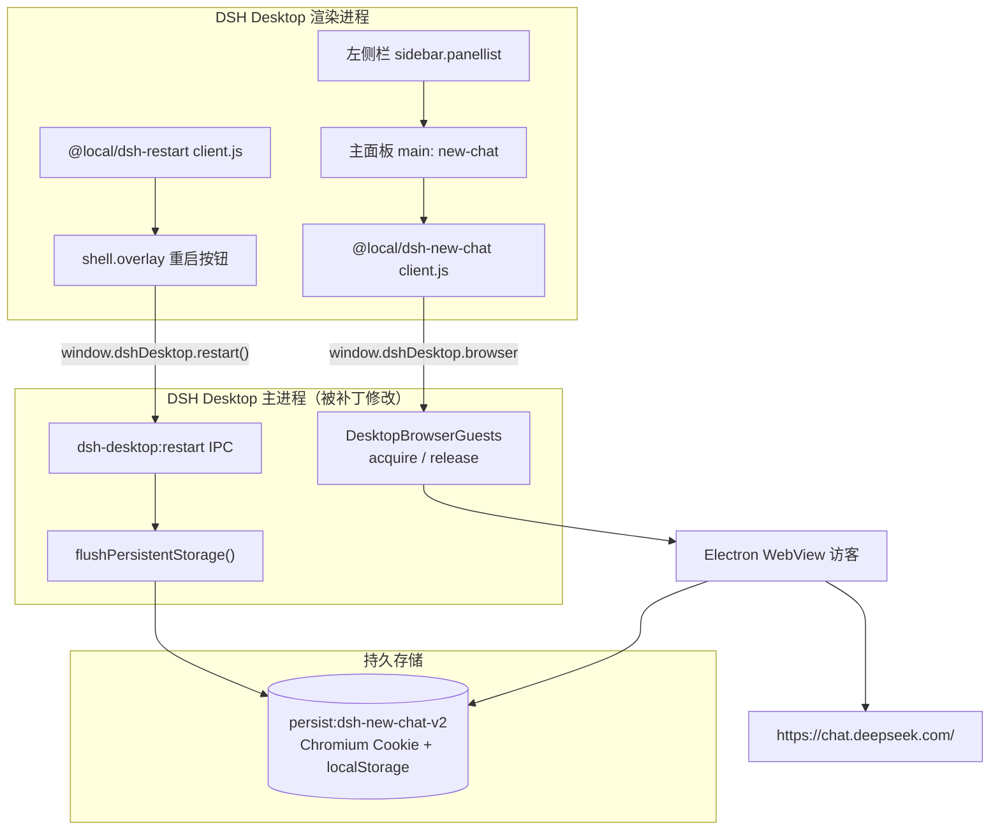
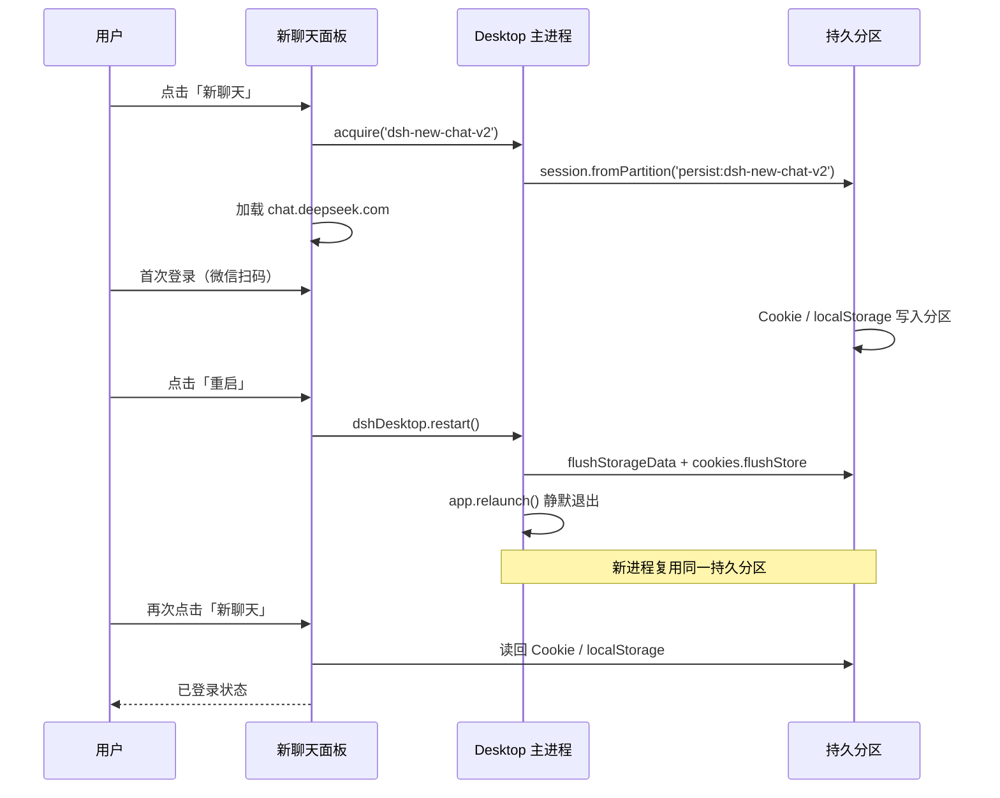

# 架构说明

本仓库由三部分组成：两个 Cordis 插件 + 一个按版本锁定的桌面补丁。三者职责分离，可独立卸载。



## 1. 为什么是 WebView 而不是 iframe

`chat.deepseek.com` 的响应头包含：

```text
content-security-policy: frame-ancestors 'none'
```

浏览器会拒绝把该页面放进任何 iframe，因此网页版 Harness 无法内嵌它。桌面端提供的
Electron `<webview>` 是独立访客（guest），不是 iframe，不受 `frame-ancestors` 约束。

插件通过页面公开的 `window.dshDesktop.browser` 桥接（preload 暴露）申请租约：

```text
client.js
  → dshDesktop.browser.acquire('dsh-new-chat-v2')
  → 得到 { lease, partition }
  → 创建 <webview name=lease partition=partition allowpopups src="about:blank#<lease>">
  → 主进程 will-attach-webview 校验所有权/分区后放行
  → dom-ready 后 view.loadURL('https://chat.deepseek.com/')
  → 卸载时 remove + release(lease)
```

主进程仍强制以下隔离策略（未修改）：无 Node 集成、contextIsolation、sandbox、权限请求拒绝、
设备权限拒绝、下载拦截、禁止访问 Harness 自身 Host、导航仅允许 http(s)（排除应用 host）。

## 2. 桌面补丁的四处改动

补丁替换 `lib/main.js` 与 `lib/preload-app.cjs`，其余打包条目逐字节保留。改动点：

| # | 位置 | 改动 |
|---|---|---|
| 1 | `DesktopBrowserGuests.acquire` | 工作区为 `dsh-new-chat-v2` 时使用持久分区 `persist:dsh-new-chat-v2`；其他工作区仍为 `dsh-sidebar-browser-<uuid>` 内存分区 |
| 2 | 新增 `DesktopBrowserGuests.flushPersistentStorage` | 对持久分区调用 `flushStorageData()` 与 `cookies.flushStore()`；不读取内容 |
| 3 | 新增 `dsh-desktop:restart` IPC | 单飞、先 flush、重新检查关闭/更新状态，再 `app.relaunch()` + 静默退出 |
| 4 | `preload-app.cjs` | 在 `window.dshDesktop` 上暴露 `restart()`（调用上面的 IPC） |

另外在退出路径上也会 flush 持久分区，保证普通关闭同样落盘。

**约束**：补丁不允许任意分区持久化，也没有改变租约所有权检查、sandbox 偏好、导航白名单、
权限/下载策略。它只让「聊天工作区」这一个分区在磁盘上持久化。

## 3. 登录保持的数据流



限制：网站在服务端让会话失效、或在别处主动退出登录时，仍需要重新登录。插件不会保存
账号密码，也不做任何凭据迁移。

## 4. 插件注册点

| 插件 | 槽位 | 说明 |
|---|---|---|
| `@local/dsh-new-chat` | `sidebar.panellist`（id `new-chat`）+ `main`（key `new-chat`） | 与内置「插件」入口同形态的导航行与全局面板 |
| `@local/dsh-restart` | `shell.overlay`（id `local-restart`） | 左上角固定按钮，不覆盖 single 槽位 |

两个插件各自注册独立的 Cordis 行（`new-chat`、`local-restart`），互不依赖。

## 5. 兼容性与版本锁定

- 目标桌面版本：`@deepseek-ai/dsh-desktop@0.2.1-rc.5`（Electron 44.7.0，Windows x64）。
- `desktop/patch-manifest.json` 固定原版两个文件的 SHA256；构建工具拒绝其他版本。
- 桌面应用升级会覆盖补丁；升级后需要针对新版本重新适配并更新 manifest。
- 补丁没有修改 Electron fuses，也没有绕过 archive 完整性校验。

更细的安装步骤见 [install.md](install.md)，验证记录见 [verification.md](verification.md)。
